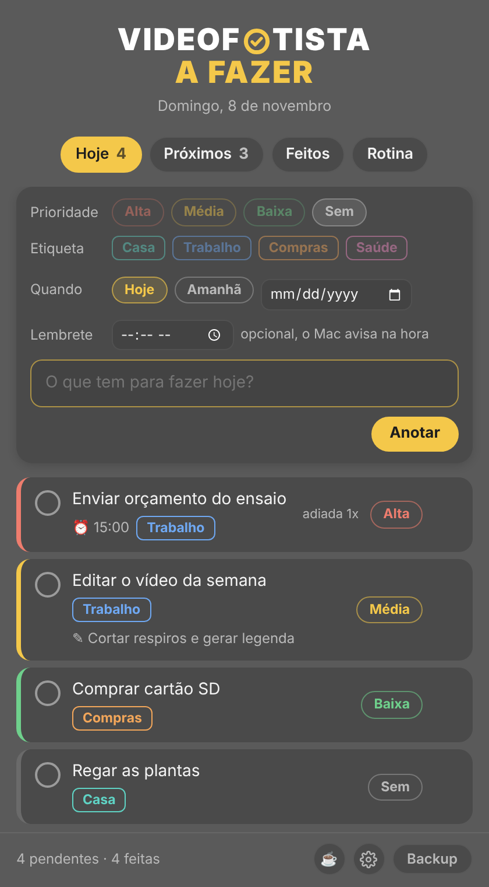
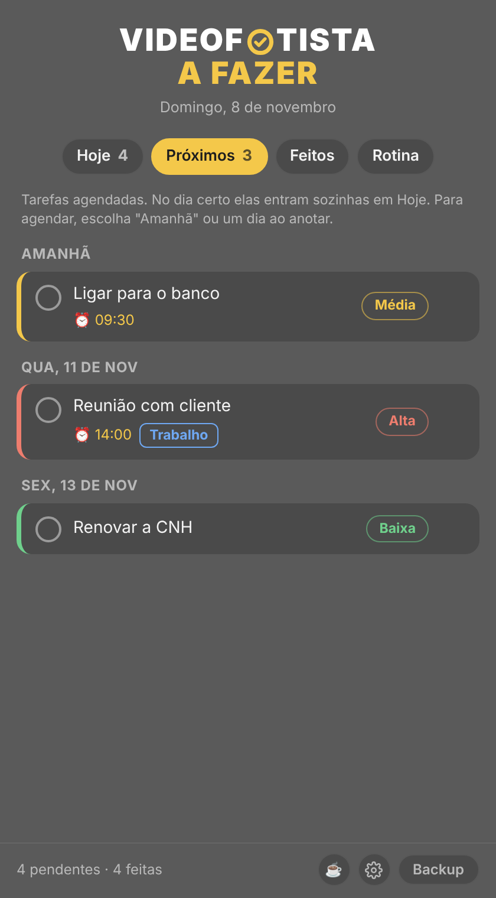
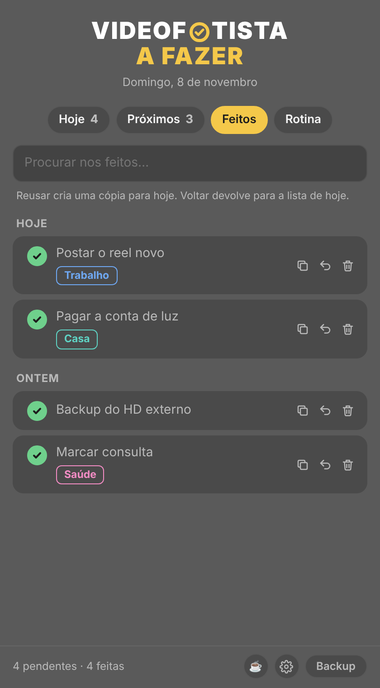
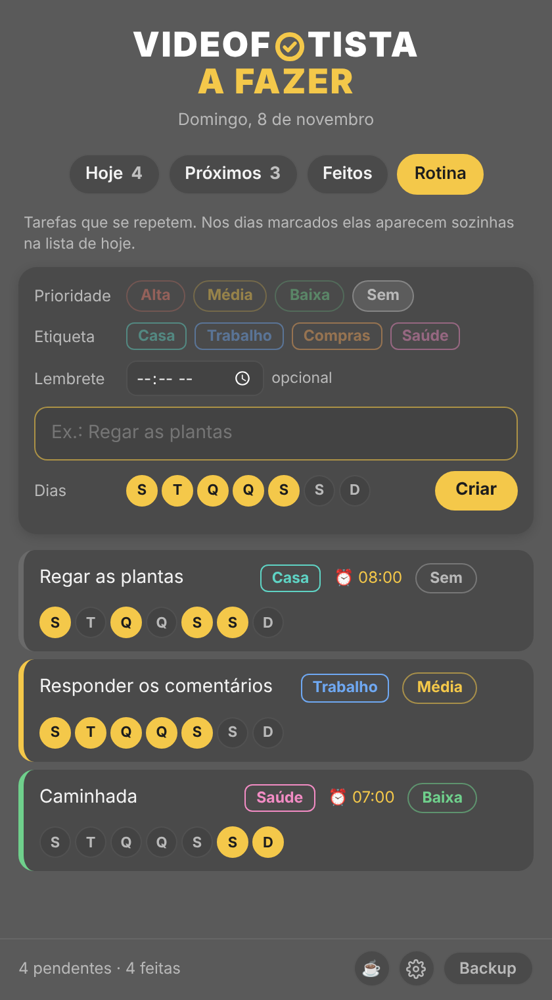
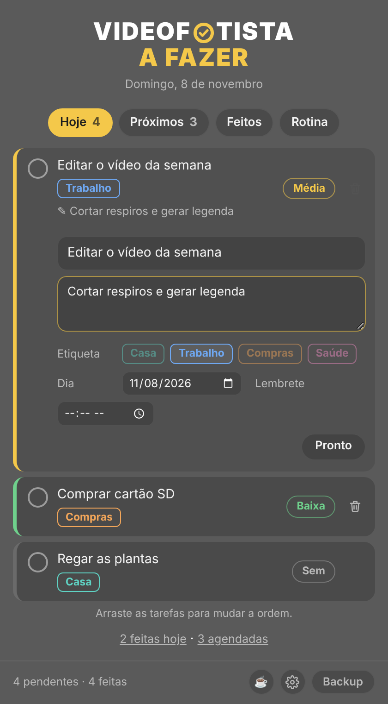
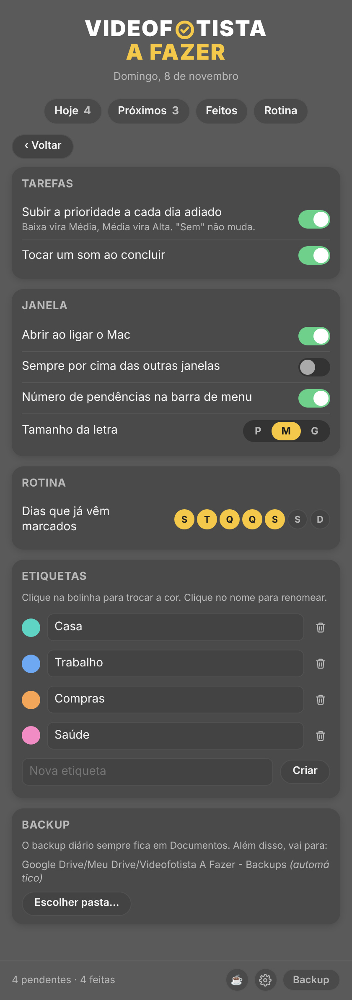

# Videofotista A Fazer

Lista de afazeres do dia, um presente de [Renato Neto, O Videofotista](https://renatoneto.com.br).
O que não for feito passa sozinho para o dia seguinte.

## O que faz

- Prioridade (Alta, Média, Baixa ou Sem) e etiquetas que você mesmo cria
- O que ficou para trás passa para o dia seguinte, com "adiada 1x, 2x…"
- Agendar para amanhã ou qualquer dia (aba Próximos)
- Lembrete com horário
- Rotinas que se repetem nos dias da semana que você escolher
- Feitos guardados, com busca, para reusar ou devolver para hoje
- Observação em cada tarefa
- Backup em arquivo (.json), com lembrete

Sem cadastro: as tarefas ficam só no seu aparelho.

## No celular (iPhone ou Android)

1. Abra **https://renatonetorj.github.io/videofotista-a-fazer/** no Safari (iPhone) ou no Chrome (Android)
2. iPhone: toque em Compartilhar e depois em **Adicionar à Tela de Início**.
   Android: menu de três pontinhos e **Instalar app**
3. Pronto: vira um ícone e funciona sem internet

No Windows, abra o mesmo endereço no Chrome ou no Edge e use **Instalar app**.
No celular, o lembrete avisa com o app aberto.

## No Mac

Baixe o arquivo **[Videofotista-A-Fazer-Mac.zip](Videofotista-A-Fazer-Mac.zip)**, descompacte e siga o LEIA-ME
(é só clicar duas vezes em **Instalar.command**). O app fica na barra de menu, abre ao ligar o Mac
e faz backup automático todo dia.

## Gostou?

Tem um "Pague um café" com Pix dentro do app, na xícara do rodapé. ☕

## Telas

| | | |
|---|---|---|
|  |  |  |
|  |  |  |
